# Data Flow Diagram — First-Time Taxpayer Registration (Level 0 → Level 3)

Scope: the first-time registration application exposed by `registration-service`
(`/api/registrations/first-time/**`) and orchestrated by the Camunda process
`reg-first-time-taxpayer` in `camunda-service`, persisting through `document-service`.

## Notation

| Shape | Meaning |
|---|---|
| Rectangle | External entity (source / sink outside the system boundary) |
| Rounded box | Process (numbered `n.0`, `n.m`, `n.m.k` by level) |
| Cylinder | Data store (`Dn`) |
| Arrow label | Data flow (what moves, not control) |

## Data dictionary — stores

| ID | Store | Owner | Physical |
|---|---|---|---|
| D1 | Registration document | document-service | `DOCUMENT_RECORD` (DRN, status, processInstanceId, taxpayerId, JSON payload) |
| D2 | Document event log | document-service | `DOCUMENT_EVENT` (CREATED, IDENTITY_VALIDATED, TAX_TYPES_PREPARED, APPLICATION_VALIDATED, TAX_TYPE_RECORDED, APPROVED, REJECTED) |
| D3 | Taxpayer register | registration-service | `REGISTRATION_TAXPAYER` |
| D4 | Tax obligations | registration-service | `REGISTRATION_TAX_OBLIGATION` |
| D5 | Process state | camunda-service | Camunda `ACT_*` tables (process variables, user tasks) |
| D6 | Issued OTPs | registration-service | In-memory set keyed `email\|telephone` (`StubOtpService`) |
| D7 | Audit trail | registration / document services | `REGISTRATION_AUDIT`, `DOCUMENT_AUDIT` (written by `AuditTrailListener` on every insert/update of D1–D4) |

## Data dictionary — external entities

| ID | Entity | Interface |
|---|---|---|
| E1 | Taxpayer applicant (individual or non-individual) | Portal → `POST /api/registrations/first-time/{individual\|non-individual}[/identity\|/contacts]` |
| E2 | NIRA (national ID registry) | authority-service `POST /api/nira/persons/lookup` |
| E3 | URSB (business registry) | authority-service URSB lookup |
| E4 | Registration Officer | Camunda Tasklist user task `ReviewRegistration` |
| E5 | Email / SMS channel | OTP delivery (stubbed) |

---

## Level 0 — Context diagram

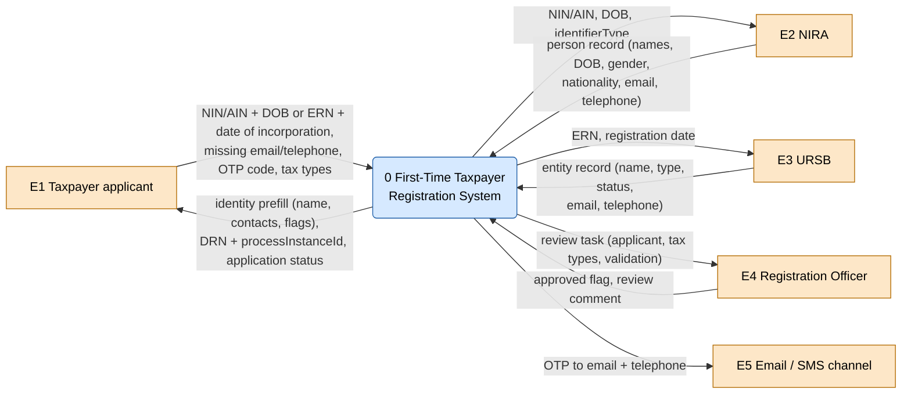

---

## Level 1 — System decomposition

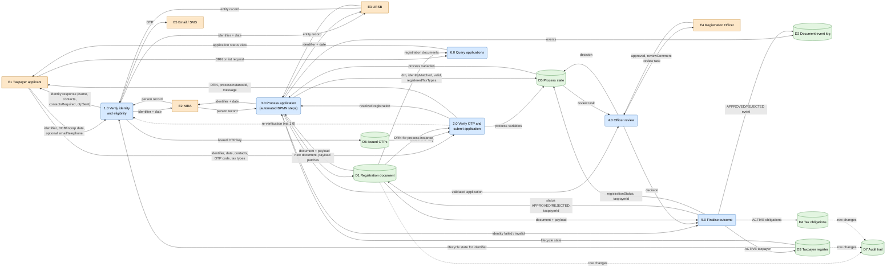

---

## Level 2 — Process decompositions

### 1.0 Verify identity and eligibility

Endpoints: `POST .../individual/identity`, `.../individual/contacts`,
`.../non-individual/identity`, `.../non-individual/contacts`.

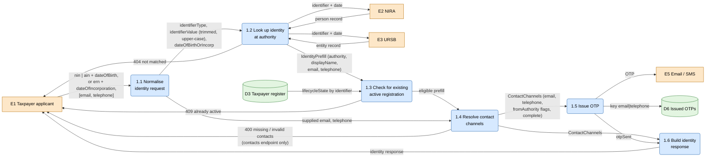

### 2.0 Verify OTP and submit application

Endpoints: `POST .../individual`, `POST .../non-individual`.

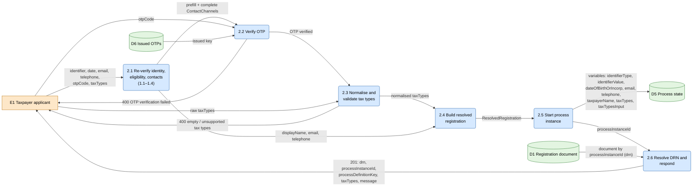

### 3.0 Process application (automated BPMN steps)

Camunda delegates in `camunda-service` → `registration-service` `/internal/reg-first-time/*`
and `document-service` `/internal/documents`.

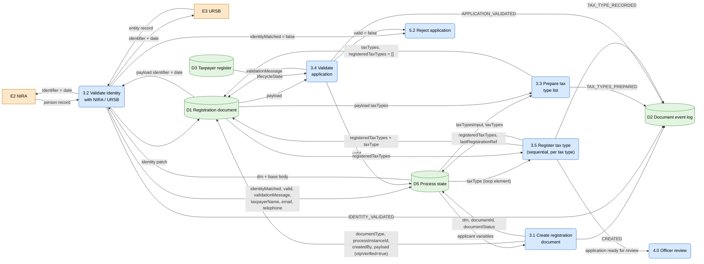

### 4.0 Officer review (primitive at Level 2)

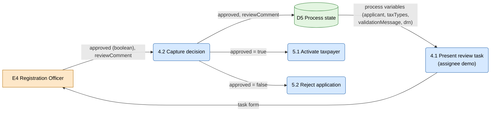

### 5.0 Finalise outcome

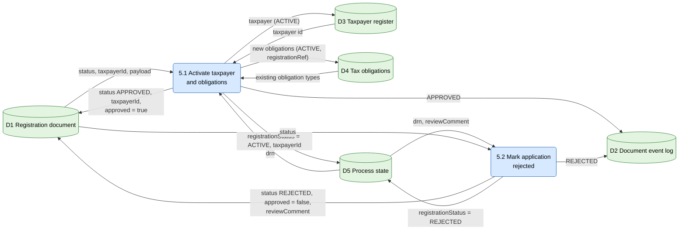

### 6.0 Query applications (primitive at Level 2)

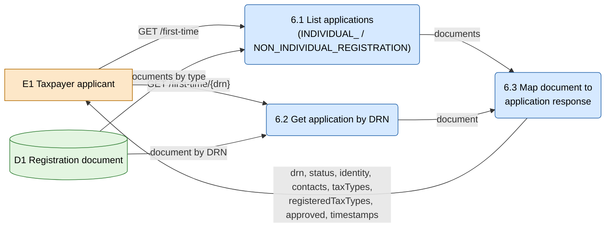

---

## Level 3 — Primitive process decompositions

### 1.2 Look up identity at authority

`IdentityLookup.lookup`, `NiraClient`, `UrsbClient`.

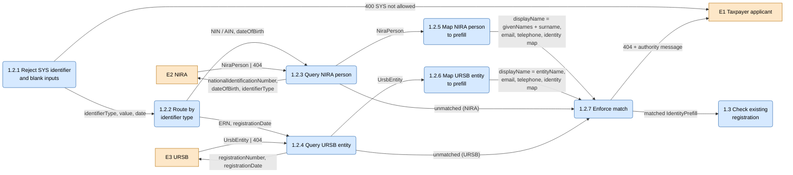

### 1.4 Resolve contact channels

`FirstTimeRegistrationService.channels`.

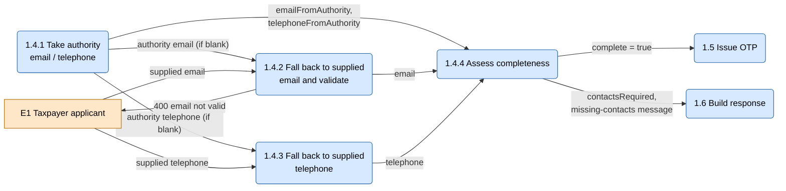

### 2.2 Verify OTP

`StubOtpService.verify`.

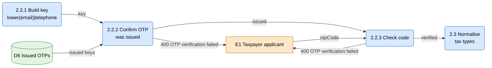

### 2.3 Normalise and validate tax types

`normalizeTaxTypes`, `validateSupportedTaxTypes` (also used by 3.3).

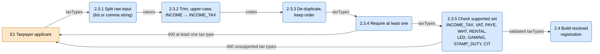

### 2.5 / 2.6 Start process instance and resolve DRN

`FirstTimeRegistrationController.start`.

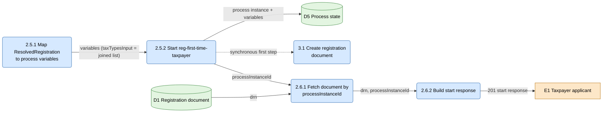

### 3.1 Create registration document

`RegCreateDocumentDelegate` → `DocumentService.create`.

```mermaid
flowchart LR
    classDef proc fill:#d6e9ff,stroke:#1f5fa8,color:#000
    classDef store fill:#e3f5e1,stroke:#2e7d32,color:#000

    D1[("D1 Registration document")]:::store
    D2[("D2 Document event log")]:::store
    D5[("D5 Process state")]:::store
    D7[("D7 Audit trail")]:::store

    P311("3.1.1 Assemble payload<br/>from process variables"):::proc
    P312("3.1.2 Derive document type<br/>ERN → NON_INDIVIDUAL_REGISTRATION<br/>else INDIVIDUAL_REGISTRATION"):::proc
    P313("3.1.3 Idempotency check<br/>by processInstanceId + type"):::proc
    P314("3.1.4 Generate DRN<br/>DRN-REG-xxxxxxxx"):::proc
    P315("3.1.5 Insert document<br/>status IN_PROGRESS"):::proc
    P316("3.1.6 Record CREATED event"):::proc
    P317("3.1.7 Store document refs<br/>in process"):::proc

    D5 -- "identifierType, identifierValue, dateOfBirthOrIncorp,<br/>email, telephone, taxpayerName, taxTypes" --> P311
    P311 -- "payload (registeredTaxTypes = [], otpVerified = true)" --> P312
    P312 -- "documentType, processInstanceId,<br/>createdBy, payload" --> P313
    D1 -- "existing document" --> P313
    P313 -- "existing document (reuse)" --> P317
    P313 -- "new request" --> P314
    P314 -- "drn" --> P315
    P315 -- "document row" --> D1
    D1 -. "row change" .-> D7
    P315 -- "document" --> P316
    P316 -- "CREATED, toStatus IN_PROGRESS" --> D2
    P315 -- "drn, id, status" --> P317
    P317 -- "drn, documentId, documentStatus" --> D5
```

### 3.2 Validate identity with NIRA / URSB

`RegValidateIdentityDelegate` → `FirstTimeRegistrationService.validateIdentity`.

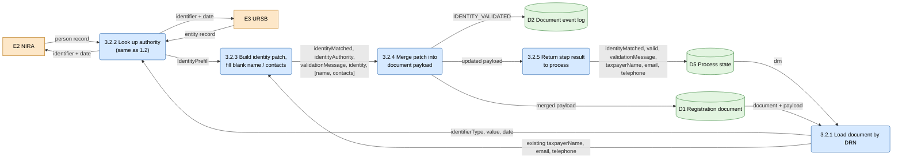

### 3.3 Prepare tax type list

`RegPrepareTaxTypesDelegate` → `FirstTimeRegistrationService.prepareTaxTypes`.

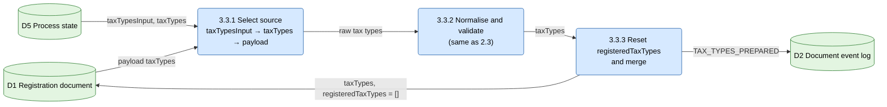

### 3.4 Validate application

`RegValidateApplicationDelegate` → `FirstTimeRegistrationService.validateApplication`.

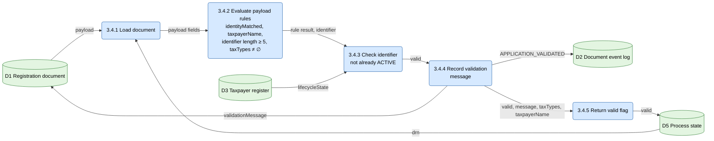

### 3.5 Register tax type (per element of `taxTypes`)

`RegRegisterTaxTypeDelegate` → `FirstTimeRegistrationService.registerTaxType`.

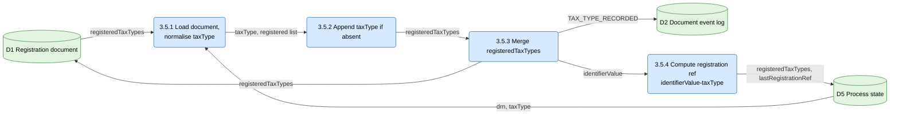

### 5.1 Activate taxpayer and obligations

`RegFinalizeRegistrationDelegate` → `FirstTimeRegistrationService.finalizeRegistration` →
`TaxpayerRegistryService.activateTaxpayer`.

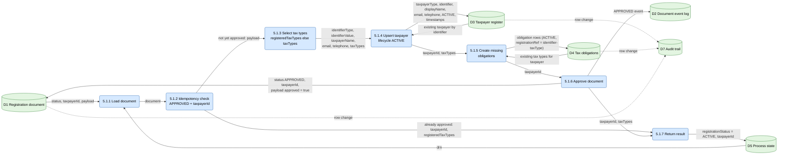

### 5.2 Mark application rejected

`RegRejectRegistrationDelegate` → `FirstTimeRegistrationService.rejectRegistration`.
Reached from three paths: identity not matched (3.2), application invalid (3.4), officer rejected (4.2).

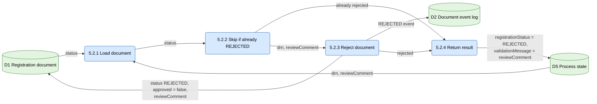

---

## Balancing notes

- Every Level 0 flow appears on Level 1, and every Level 1 flow into or out of a process is
  carried by at least one of its Level 2 children (e.g. the NIRA/URSB flows of 1.0 and 3.0
  are realised by 1.2 and 3.2, and detailed in 1.2.x / 3.2.x).
- 4.0 and 6.0 have no Level 3 because their Level 2 processes are already primitive
  (a single form submission and a single read-and-map).
- D7 (audit) is not written by any process directly; it is a side effect of JPA
  `@PostPersist` / `@PostUpdate` on D1, D3 and D4 rows, so it is shown with dotted flows.
- D6 is in-memory in the current stub: OTPs do not survive a registration-service restart,
  and any code of 4+ characters is accepted for an issued key.
